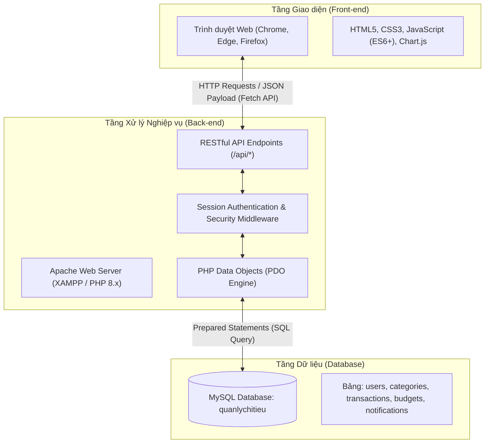
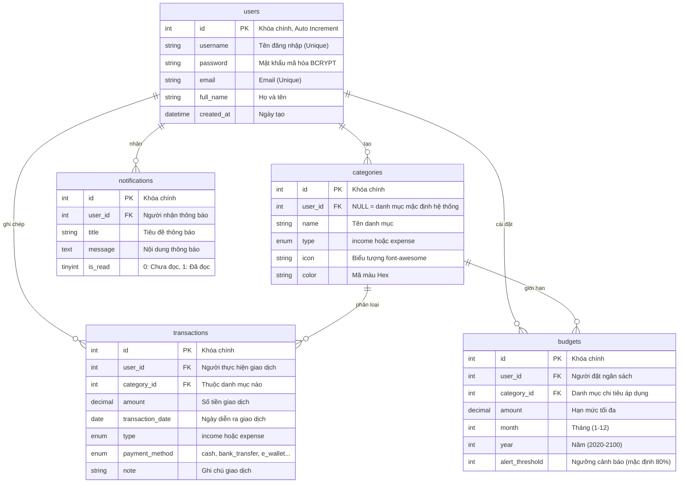

# BÁO CÁO TIẾN ĐỘ LẦN 1 - HỆ THỐNG QUẢN LÝ TÀI CHÍNH CÁ NHÂN (CASHMANAGER)

> **Môn học:** Phát triển ứng dụng Web / Công nghệ phần mềm  
> **Hạn nộp:** 18/11/2026 - 23:59  
> **Sản phẩm bàn giao:** File Slide thuyết trình (7-10 slide) + Video clip demo thực hành (3-5 phút).

---

## MỤC LỤC
1. [Sơ đồ kiến trúc Website](#1-sơ-đồ-kiến-trúc-website)
2. [Danh sách chức năng đã hoàn thành & chưa hoàn thành](#2-danh-sách-chức-năng-đã-hoàn-thành--chưa-hoàn-thành)
3. [Giao diện các trang chính](#3-giao-diện-các-trang-chính)
4. [Các chức năng đã kết nối với Back-end](#4-các-chức-năng-đã-kết-nối-với-back-end)
5. [Cơ chế gửi dữ liệu từ Front-end lên Server](#5-cơ-chế-gửi-dữ-liệu-từ-front-end-lên-server)
6. [Cơ chế Back-end xử lý và trả kết quả về Front-end](#6-cơ-chế-back-end-xử-lý-và-trả-kết-quả-về-front-end)
7. [Thiết kế Cơ sở dữ liệu (Database Design)](#7-thiết-kế-cơ-sở-dữ-liệu-database-design)
8. [Kịch bản quay Clip Demo thực hành chứng minh Database](#8-kịch-bản-quay-clip-demo-thực-hành-chứng-minh-database)
9. [Cấu trúc chi tiết 10 Slide thuyết trình](#9-cấu-trúc-chi-tiết-10-slide-thuyết-trình)

---

## 1. Sơ đồ kiến trúc Website

Hệ thống được xây dựng theo mô hình kiến trúc 3 lớp tiêu chuẩn (**3-Tier Client-Server Architecture**):



* **Front-end:** Chạy hoàn toàn trên trình duyệt người dùng, gửi/nhận dữ liệu không tải lại trang qua `fetch()` API.
* **Back-end:** Xử lý xác thực người dùng qua `$_SESSION`, kiểm tra dữ liệu hợp lệ (Validation), chống tấn công SQL Injection bằng PDO Prepared Statements.
* **Database:** Hệ quản trị MySQL lưu trữ dữ liệu tập trung với quan hệ khóa chính (Primary Key), khóa ngoại (Foreign Key) và ràng buộc toàn vẹn `ON DELETE CASCADE`.

---

## 2. Danh sách chức năng đã hoàn thành & chưa hoàn thành

| STT | Phân hệ / Chức năng | Chi tiết nghiệp vụ | Trạng thái |
| :---: | :--- | :--- | :---: |
| 1 | **Xác thực (Authentication)** | Đăng ký tài khoản, đăng nhập mã hóa BCRYPT, đăng xuất, lưu phiên làm việc (Session). | ✅ Đã hoàn thành |
| 2 | **Bảng điều khiển (Dashboard)** | 4 thẻ KPI tài chính (Thu, Chi, Dư ròng, Tiết kiệm), widget ngân sách tháng, biểu đồ xu hướng 12 tháng. | ✅ Đã hoàn thành |
| 3 | **Quản lý Thu nhập (Income)** | Xem danh sách, thêm mới, sửa, xóa khoản thu, lọc theo danh mục / ngày tháng, phân trang. | ✅ Đã hoàn thành |
| 4 | **Quản lý Chi tiêu (Expense)** | Xem danh sách, thêm mới, sửa, xóa khoản chi, lọc theo danh mục / ngày tháng, phân trang. | ✅ Đã hoàn thành |
| 5 | **Kế hoạch Ngân sách (Budget)** | Đặt hạn mức chi theo từng danh mục theo tháng/năm, tính % đã tiêu, cảnh báo chạm ngưỡng / vượt mức. | ✅ Đã hoàn thành |
| 6 | **Báo cáo & Thống kê (Report)** | Báo cáo theo kỳ (tháng/năm/tùy chọn ngày), vẽ biểu đồ Bar, Doughnut, Pie với Chart.js, xuất file CSV. | ✅ Đã hoàn thành |
| 7 | **Tài khoản & Danh mục riêng** | Cập nhật hồ sơ (họ tên, email), đổi mật khẩu an toàn, tự thêm danh mục thu/chi cá nhân. | ✅ Đã hoàn thành |
| 8 | **Gợi ý tài chính thông minh (AI)** | Tự động phân tích thói quen chi tiêu và đưa ra lời khuyên tiết kiệm thông minh. | ⏳ Dự kiến Lần 2 |
| 9 | **Quét hóa đơn tự động (OCR)** | Nhận diện hóa đơn mua sắm để tự điền giao dịch chi tiêu. | ⏳ Dự kiến Lần 2 |

---

## 3. Giao diện các trang chính

1. **Trang Bảng điều khiển (`pages/dashboard.html`):**
   * Tổng quan tình hình tài chính của tháng hiện tại với 4 thẻ KPI nổi bật.
   * Thanh tiến độ ngân sách tổng quan.
   * Biểu đồ xu hướng tài chính và cơ cấu chi tiêu.
2. **Trang Quản lý Thu nhập (`pages/income.html`):**
   * Thanh công cụ lọc linh hoạt: theo khoảng ngày, theo danh mục.
   * Bảng hiển thị giao dịch kèm nút Thao tác (Sửa, Xóa).
   * Modal thêm/sửa thu nhập với tính năng chọn nhanh danh mục có biểu tượng (icon) và màu sắc.
3. **Trang Quản lý Chi tiêu (`pages/expense.html`):**
   * Giao diện theo dõi các khoản chi tiêu hàng ngày.
   * Đồng bộ tự động kiểm tra vượt hạn mức ngân sách khi tạo khoản chi mới.
4. **Trang Kế hoạch Ngân sách (`pages/budget.html`):**
   * Bộ lọc theo từng tháng và năm.
   * Thẻ ngân sách trực quan tự đổi màu: Xanh lá (Bình thường), Vàng cam (Sắp chạm ngưỡng cảnh báo $\ge 80\%$), Đỏ (Vượt hạn mức $100\%$).
5. **Trang Báo cáo Thống kê (`pages/report.html`):**
   * Lọc báo cáo linh hoạt theo kỳ thời gian hoặc tùy chỉnh ngày.
   * 3 biểu đồ Chart.js: Xu hướng thu chi, Cơ cấu chi tiêu, Phân bổ nguồn thu.
   * Tích hợp nút xuất báo cáo giao dịch ra file CSV.
6. **Trang Cài đặt Tài khoản (`pages/account.html`):**
   * Form cập nhật họ tên, email.
   * Form đổi mật khẩu bảo mật.
   * Quản lý các danh mục riêng do chính người dùng tự tạo.

---

## 4. Các chức năng đã kết nối với Back-end

Hệ thống đã kết nối hoàn chỉnh giữa Front-end và Back-end thông qua bộ RESTful API viết bằng PHP:

| Endpoint Back-end | Phương thức | Chức năng Front-end kết nối tương ứng |
| :--- | :---: | :--- |
| `api/auth/login.php` | `POST` | Đăng nhập tài khoản |
| `api/auth/register.php` | `POST` | Đăng ký tài khoản mới |
| `api/auth/me.php` | `GET` | Lấy thông tin người dùng đang đăng nhập trong phiên |
| `api/auth/logout.php` | `POST` | Đăng xuất và hủy phiên làm việc |
| `api/transaction/list.php` | `GET` | Lấy danh sách giao dịch thu/chi có phân trang và lọc |
| `api/transaction/add.php` | `POST` | Thêm khoản thu hoặc chi tiêu mới vào database |
| `api/transaction/edit.php` | `POST` | Chỉnh sửa giao dịch đã có |
| `api/transaction/delete.php` | `POST` | Xóa giao dịch khỏi database |
| `api/budget/get.php` | `GET` | Lấy dữ liệu hạn mức và số tiền đã chi theo tháng/năm |
| `api/budget/set.php` | `POST` | Thiết lập hạn mức ngân sách cho từng danh mục |
| `api/budget/delete.php` | `POST` | Xóa hạn mức ngân sách |
| `api/report/summary.php` | `GET` | Tổng hợp thu, chi, số dư ròng, xu hướng 12 tháng |
| `api/report/by_category.php` | `GET` | Tổng hợp số liệu theo từng nhóm danh mục |
| `api/export/export_csv.php` | `GET` | Xuất file dữ liệu giao dịch ra file `.csv` tải về máy |
| `api/account/update.php` | `POST` | Cập nhật thông tin tài khoản |
| `api/account/change_password.php`| `POST` | Đổi mật khẩu tài khoản |

---

## 5. Cơ chế gửi dữ liệu từ Front-end lên Server

Front-end sử dụng hàm tiêu chuẩn `fetch()` của JavaScript (ES6) để giao tiếp bất đồng bộ (AJAX) mà không cần tải lại toàn bộ trang web:

### 1. Phương thức `GET` (Đọc dữ liệu)
Truyền tham số lọc qua chuỗi truy vấn (URL Query Parameters):
```javascript
// Ví dụ: Lấy danh sách chi tiêu của trang 1, lọc theo tháng
const response = await fetch('../api/transaction/list.php?type=expense&page=1&from_date=2026-11-01', {
    method: 'GET',
    credentials: 'same-origin'
});
const result = await response.json();
```

### 2. Phương thức `POST` (Tạo mới, Cập nhật, Xóa)
Đóng gói dữ liệu đối tượng JavaScript thành chuỗi JSON và gửi trong `body` của HTTP Request:
```javascript
// Ví dụ: Gửi dữ liệu tạo khoản chi tiêu mới
const payload = {
    category_id: 2,
    amount: 85000,
    transaction_date: '2026-11-18',
    type: 'expense',
    payment_method: 'cash',
    note: 'Ăn trưa cùng đồng nghiệp'
};

const response = await fetch('../api/transaction/add.php', {
    method: 'POST',
    credentials: 'same-origin',
    headers: {
        'Content-Type': 'application/json'
    },
    body: JSON.stringify(payload)
});
const result = await response.json();
```

---

## 6. Cơ chế Back-end xử lý và trả kết quả về Front-end

Quy trình chuẩn hóa trong tất cả các API Back-end của dự án gồm 5 bước:

1. **Kiểm tra Phương thức & Nhận dữ liệu:**
   ```php
   if ($_SERVER['REQUEST_METHOD'] !== 'POST') {
       jsonResponse(['error' => 'Phương thức không hợp lệ'], 405);
   }
   // Giải mã JSON từ request body
   $data = json_decode(file_get_contents('php://input'), true) ?? [];
   ```

2. **Xác thực phiên làm việc (Authentication Middleware):**
   ```php
   // Hàm requireAuth() kiểm tra $_SESSION['user_id']
   // Nếu chưa đăng nhập lập tức trả về HTTP 401 Unauthorized
   $userId = requireAuth();
   ```

3. **Kiểm tra tính hợp lệ của dữ liệu (Validation):**
   * Kiểm tra số tiền phải là số dương (`amount > 0`).
   * Kiểm tra định dạng ngày (`YYYY-MM-DD`).
   * Kiểm tra danh mục có tồn tại và thuộc quyền sở hữu của user hay không.

4. **Thực thi Database an toàn với PDO Prepared Statements:**
   ```php
   $pdo = getDbConnection();
   $stmt = $pdo->prepare("
       INSERT INTO transactions (user_id, category_id, amount, transaction_date, type, payment_method, note)
       VALUES (?, ?, ?, ?, ?, ?, ?)
   ");
   $stmt->execute([$userId, $categoryId, $amount, $date, $type, $method, $note]);
   ```

5. **Trả kết quả về Front-end định dạng JSON:**
   ```php
   header('Content-Type: application/json; charset=utf-8');
   echo json_encode([
       'success' => true,
       'message' => 'Thêm giao dịch thành công',
       'data'    => ['id' => $pdo->lastInsertId()]
   ]);
   exit;
   ```

---

## 7. Thiết kế Cơ sở dữ liệu (Database Design)

### Sơ đồ quan hệ thực thể (ERD)


* **Khóa chính (PK):** Tất cả các bảng đều có trường `id` kiểu số nguyên tăng tự động (`AUTO_INCREMENT`).
* **Khóa ngoại (FK) & Ràng buộc toàn vẹn:**
  * `transactions.user_id` $\rightarrow$ `users.id` (`ON DELETE CASCADE`)
  * `transactions.category_id` $\rightarrow$ `categories.id` (`ON DELETE RESTRICT`)
  * `budgets.user_id` $\rightarrow$ `users.id` (`ON DELETE CASCADE`)
  * `budgets.category_id` $\rightarrow$ `categories.id` (`ON DELETE CASCADE`)

---

## 8. Kịch bản quay Clip Demo thực hành chứng minh Database

> **Thời lượng clip khuyến nghị:** 3 - 5 phút.  
> **Phần mềm quay màn hình:** OBS Studio, CapCut, hoặc tính năng quay màn hình của Windows (`Win + G` hoặc `Win + Alt + R`).

### Chuẩn bị trước khi bấm quay:
1. Mở sẵn 2 cửa sổ cạnh nhau (chia đôi màn hình):
   * **Cửa sổ 1 (Trái):** Website chạy tại `http://localhost/Financial_manager/pages/dashboard.html` (đã đăng nhập tài khoản demo).
   * **Cửa sổ 2 (Phải):** Trang **phpMyAdmin** (`http://localhost/phpmyadmin`), chọn cơ sở dữ liệu `quanlychitieu`, mở sẵn bảng `transactions`.

### Các bước trình bày trong Clip:

* **0:00 - 0:30 (Mở đầu & Giới thiệu):**
  * *"Xin chào Thầy/Cô và các bạn, hôm nay nhóm em xin trình bày video báo cáo tiến độ lần 1 cho dự án Quản lý chi tiêu cá nhân. Sau đây là phần chứng minh tính năng thực hành có kết nối và lưu trữ trực tiếp vào cơ sở dữ liệu MySQL."*
* **0:30 - 1:45 (Demo Chức năng 1: Thêm khoản giao dịch mới - Create):**
  * Trên giao diện Web, bấm vào trang **Chi tiêu** (`expense.html`).
  * Nhấn nút **"Thêm chi tiêu"**.
  * Chọn Danh mục: **Ăn uống**, Nhập số tiền: **150,000 đ**, Ngày: Hôm nay, Ghi chú: **"Ăn trưa báo cáo tiến độ"**.
  * Bấm nút **"Lưu giao dịch"**. Danh sách trên Web ngay lập tức hiện khoản chi 150,000 đ.
  * **Hành động chứng minh:** Chuyển sang cửa sổ phpMyAdmin $\rightarrow$ Nhấn nút **Duyệt (Browse)** hoặc F5 $\rightarrow$ Chỉ chuột vào dòng cuối cùng vừa được thêm vào với đúng `amount = 150000.00` và `note = 'Ăn trưa báo cáo tiến độ'`.
* **1:45 - 2:45 (Demo Chức năng 2: Chỉnh sửa giao dịch - Update):**
  * Quay lại màn hình Web, tìm giao dịch vừa tạo, bấm nút **Sửa (biểu tượng cây bút)**.
  * Sửa số tiền từ `150,000 đ` thành `200,000 đ`.
  * Bấm **"Lưu thay đổi"**. Giao diện web cập nhật thành 200,000 đ.
  * **Hành động chứng minh:** Chuyển sang phpMyAdmin $\rightarrow$ Nhấn Duyệt (Browse) $\rightarrow$ Chứng minh trường `amount` trong database đã đổi sang `200000.00`.
* **2:45 - 3:30 (Demo Chức năng 3: Xóa giao dịch - Delete):**
  * Bấm nút **Xóa (biểu tượng thùng rác)** của giao dịch đó trên web $\rightarrow$ Xác nhận xóa. Giao dịch biến mất khỏi bảng.
  * **Hành động chứng minh:** Sang phpMyAdmin F5 lại $\rightarrow$ Dòng dữ liệu đã được xóa hoàn toàn khỏi MySQL.
* **3:30 - 4:00 (Kết luận):**
  * *"Như vậy, nhóm em đã chứng minh hoàn chỉnh luồng dữ liệu từ Front-end gửi lên Back-end PHP xử lý, và các thao tác Thêm - Sửa - Xóa đều tác động trực tiếp, chính xác vào cơ sở dữ liệu MySQL. Em xin cảm ơn Thầy/Cô đã theo dõi."*

---

## 9. Cấu trúc chi tiết 10 Slide thuyết trình

* **Slide 1:** Tiêu đề dự án, Tên môn học, Giảng viên hướng dẫn, Danh sách thành viên nhóm.
* **Slide 2:** Tổng quan đề tài & Mục tiêu dự án Quản lý tài chính cá nhân.
* **Slide 3:** Sơ đồ kiến trúc hệ thống 3 lớp (Front-end $\leftrightarrow$ Back-end $\leftrightarrow$ Database).
* **Slide 4:** Bảng tổng hợp tiến độ chức năng (Đã hoàn thành vs Kế hoạch giai đoạn tới).
* **Slide 5:** Thiết kế cơ sở dữ liệu (Sơ đồ ERD và quan hệ các bảng).
* **Slide 6:** Giao diện các phân hệ chính (Dashboard, Thu nhập, Chi tiêu).
* **Slide 7:** Giao diện phân hệ nâng cao (Kế hoạch ngân sách, Báo cáo biểu đồ Chart.js).
* **Slide 8:** Cơ chế giao tiếp Front-end $\rightarrow$ Back-end (Fetch API, phương thức GET & POST JSON).
* **Slide 9:** Cơ chế xử lý Back-end (Validation, Session Auth, PDO Prepared Statements chống SQL Injection).
* **Slide 10:** Video Demo thực hành chứng minh Database & Lời cảm ơn / Q&A.
