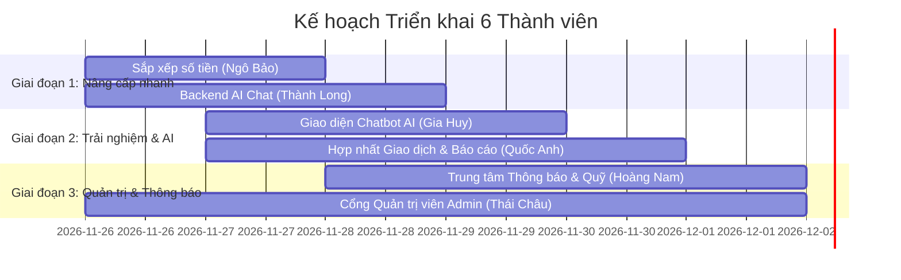

# KẾ HOẠCH PHÂN CÔNG NHIỆM VỤ TIẾP THEO (DÀNH CHO 6 THÀNH VIÊN)

> **Dự án**: CashManager – Hệ thống Quản lý Chi tiêu Cá nhân & Quỹ chung  
> **Mục tiêu**: Phát triển Cổng Quản trị viên (Admin), hợp nhất luồng giao dịch & báo cáo, nâng cấp sắp xếp dữ liệu, tích hợp Chatbot AI hỏi-đáp tài chính hai chiều và hoàn thiện Trung tâm thông báo & lời mời quỹ chung.

---

## 1. BẢNG TỔNG HỢP PHÂN CÔNG (6 THÀNH VIÊN)

| STT | Thành viên | Nhánh Git | Nhiệm vụ chính phụ trách |
| :---: | :--- | :--- | :--- |
| **1** | **Thái Châu** *(Lead)* | `feature/chau` | **Phân hệ Quản trị viên (Admin Portal)**: Quản lý tài khoản, phân quyền, khóa/mở user, thống kê hệ thống. |
| **2** | **Lê Quốc Anh** | `feature/qanh` | **Hợp nhất Giao diện**: Gộp Thu nhập – Chi tiêu – Báo cáo thành Module "Sổ Giao Dịch & Báo Cáo" (Tab view). |
| **3** | **Ngô Bảo** | `feature/ngbao` | **Nâng cấp Bảng dữ liệu**: Bổ sung sắp xếp Số tiền Tăng dần / Giảm dần (`⇅`) & Bộ lọc giao dịch. |
| **4** | **Trần Gia Huy** | `feature/huy` | **Giao diện Chatbot AI**: Xây dựng khung chat tương tác hỏi – đáp tài chính cá nhân trực tiếp trên Dashboard. |
| **5** | **Thành Long** | `feature/longthanh` | **Backend Chatbot AI**: Xây dựng API `/api/ai/chat.php` kết nối Google Gemini theo ngữ cảnh tài chính của user. |
| **6** | **Hoàng Nam** | `feature/nam` | **Trung tâm Thông báo**: Biểu tượng Chuông Header + Nhận thông báo hệ thống & Xử lý Lời mời Quỹ chung. |

---

## 2. CHI TIẾT NHIỆM VỤ TỪNG THÀNH VIÊN

---

### 👤 THÀNH VIÊN 1: THÁI CHÂU (Phụ trách: Cổng Quản trị viên Admin)
* **Mục tiêu**: Xây dựng hoàn chỉnh Cổng Quản trị viên cho phép kiểm soát tài khoản người dùng và giám sát toàn hệ thống.
* **Công việc cụ thể**:
  1. **Quản lý danh sách tài khoản** (`pages/admin/dashboard.html` & `pages/admin/users.html`):
     - Hiển thị bảng toàn bộ tài khoản: ID, Username, Email, Họ tên, Vai trò (Admin/User), Trạng thái (Hoạt động/Bị khóa), Ngày tạo.
     - Ô tìm kiếm nhanh và phân trang danh sách tài khoản.
  2. **Hành động Quản trị viên** (`api/admin/users.php`):
     - Chức năng **Khóa / Mở khóa tài khoản** (cập nhật cột `status = 'active' | 'banned'`).
     - Chức năng **Thăng cấp / Hạ cấp vai trò** (`role = 'admin' | 'user'`).
     - Chức năng **Đặt lại mật khẩu khẩn cấp** cho người dùng khi được yêu cầu.
  3. **Thống kê tổng quan hệ thống**:
     - Thẻ đếm số lượng: Tổng người dùng, Số admin, Tổng giao dịch hệ thống, Số quỹ chung đang chạy.
     - Biểu đồ tăng trưởng người dùng mới theo tuần.
  4. **Bảo mật**: Áp dụng hàm `requireAdmin()` bảo vệ tuyệt đối tất cả các API quản trị.

---

### 👤 THÀNH VIÊN 2: LÊ QUỐC ANH (Phụ trách: Hợp nhất Thu nhập – Chi tiêu – Báo cáo)
* **Mục tiêu**: Gọn hóa thanh menu, gộp 3 trang rời rạc thành một màn hình **"Sổ Giao Dịch & Báo Cáo"** duy nhất.
* **Công việc cụ thể**:
  1. **Rút gọn Sidebar**:
     - Bỏ 3 mục riêng lẻ `Thu nhập`, `Chi tiêu`, `Báo cáo` trên menu.
     - Thay bằng 1 mục duy nhất: `<i class="fa-solid fa-book-bookmark"></i> Sổ giao dịch & Báo cáo` (`pages/transactions.html`).
  2. **Thiết kế hệ thống 4 Tab**:
     - **Tab 1 - Tất cả giao dịch**: Xem chung cả Thu (màu xanh `+`) và Chi (màu đỏ `-`) trên một bảng. Có 2 nút thêm nhanh `+ Thu nhập` và `- Chi tiêu`.
     - **Tab 2 - Khoản Chi**: Lọc riêng chi tiêu, giữ nguyên nút **AI Quét hóa đơn OCR**.
     - **Tab 3 - Khoản Thu**: Quản lý các nguồn thu nhập (lương, thưởng, kinh doanh,...).
     - **Tab 4 - Báo cáo & Xuất file**: Hiển thị biểu đồ tròn cơ cấu danh mục, biểu đồ cột thu-chi và các nút xuất file **Excel, CSV, PDF**.
  3. **Tương thích di động**: Đảm bảo thanh chuyển tab cuộn ngang mượt mà trên điện thoại.

---

### 👤 THÀNH VIÊN 3: NGÔ BẢO (Phụ trách: Sắp xếp Số tiền Tăng/Giảm dần)
* **Mục tiêu**: Giúp người dùng dễ dàng tìm kiếm khoản chi/thu lớn nhất hoặc nhỏ nhất.
* **Công việc cụ thể**:
  1. **Giao diện cột Số tiền**:
     - Thêm icon sắp xếp `⇅` vào tiêu đề cột **"Số tiền"** trên tất cả các bảng giao dịch.
     - Trạng thái 1 (Mặc định): Sắp xếp theo ngày mới nhất.
     - Trạng thái 2 (Click lần 1): Sắp xếp **Số tiền Giảm dần** (từ lớn đến bé, icon `↓`).
     - Trạng thái 3 (Click lần 2): Sắp xếp **Số tiền Tăng dần** (từ bé đến lớn, icon `↑`).
  2. **Xử lý JavaScript & API**:
     - Viết logic sắp xếp nhanh trên client trong `assets/js/search.js` / module bảng.
     - Hỗ trợ tham số truy vấn backend: `api/transactions/read.php?sort_by=amount&order=desc|asc`.
  3. **Bộ lọc nâng cao**: Kết hợp mượt mà giữa sắp xếp số tiền với bộ lọc khoảng ngày và lọc danh mục.

---

### 👤 THÀNH VIÊN 4: TRẦN GIA HUY (Phụ trách: Giao diện Chatbot Trợ lý AI)
* **Mục tiêu**: Nâng cấp mục "Trợ lý tài chính AI" trên Bảng điều khiển từ đánh giá một chiều thành **Chatbot hỏi – đáp tương tác hai chiều**.
* **Công việc cụ thể**:
  1. **Khung nhập câu hỏi tương tác** (`pages/dashboard.html`):
     - Thêm ô `input` nhập câu hỏi bên dưới phần đánh giá tự động: `Nhập câu hỏi tài chính cho AI (VD: Tôi có nên mua xe máy mới lúc này không?)...`
     - Nút `[ Gửi ]` với icon máy bay giấy `<i class="fa-solid fa-paper-plane"></i>`.
  2. **Gợi ý câu hỏi nhanh (Quick Prompts)**:
     - Tạo 3 nút chip câu hỏi mẫu bấm là gửi ngay:
       * 💡 *"Làm sao để tháng sau tôi tiết kiệm được 2 triệu?"*
       * 📱 *"Với thu nhập hiện tại, tôi có nên mua điện thoại mới không?"*
       * 🥗 *"Gợi ý cách giảm 30% tiền ăn uống tháng tới?"*
  3. **Trải nghiệm tương tác (UX)**:
     - Hiệu ứng loading icon xoay spinner trong lúc AI đang suy nghĩ.
     - Hiển thị câu trả lời của AI dạng tin nhắn có định dạng rõ ràng, dễ đọc.

---

### 👤 THÀNH VIÊN 5: THÀNH LONG (Phụ trách: Backend Chatbot AI Gemini)
* **Mục tiêu**: Xây dựng API tiếp nhận câu hỏi của người dùng và kết nối Google Gemini AI để đưa ra câu trả lời cá nhân hóa theo ví tiền thật.
* **Công việc cụ thể**:
  1. **Xây dựng API `api/ai/chat.php`**:
     - Tiếp nhận phương thức `POST { question: "..." }`.
     - Xác thực session đăng nhập bằng `requireAuth()`.
  2. **Thu thập ngữ cảnh tài chính của người dùng**:
     - Lấy tổng thu tháng, tổng chi tháng, số dư ròng, tỷ lệ tiết kiệm hiện tại.
     - Lấy danh mục đang tiêu nhiều tiền nhất tháng.
  3. **Xây dựng System Prompt gửi Gemini**:
     - Prompt cung cấp toàn bộ bức tranh tài chính của user và yêu cầu Gemini đóng vai trò **Cố vấn tài chính cá nhân**, trả lời thẳng vào câu hỏi của người dùng một cách thực tế và khích lệ.
  4. **Tích hợp cURL & Cơ chế chịu lỗi**:
     - Đặt `CURLOPT_SSL_VERIFYPEER => false` cho môi trường dev Windows.
     - Cơ chế fallback: Nếu chưa có `GEMINI_API_KEY` hoặc lỗi mạng, hệ thống vẫn phản hồi câu trả lời dựa trên quy tắc tài chính thông minh (Rule-based).

---

### 👤 THÀNH VIÊN 6: HOÀNG NAM (Phụ trách: Trung tâm Thông báo & Lời mời Quỹ chung)
* **Mục tiêu**: Xây dựng hệ thống thông báo tập trung, cho phép người dùng nhận tin nhắn hệ thống và phản hồi Lời mời tham gia Quỹ chung.
* **Công việc cụ thể**:
  1. **Biểu tượng Chuông Thông báo trên Header**:
     - Thêm icon `<i class="fa-solid fa-bell"></i>` trên góc phải Header cạnh tên người dùng.
     - Badge màu đỏ hiển thị số lượng thông báo chưa đọc (`unread_count`).
     - Bấm vào chuông mở Dropdown danh sách thông báo.
  2. **Thông báo Hệ thống**:
     - Hiển thị thông báo nhắc nhở chi tiêu ban đêm.
     - Hiển thị thông báo cảnh báo khi danh mục chạm hạn mức ngân sách.
  3. **Xử lý Lời mời Quỹ chung (Shared Space Invitation)**:
     - Khi được bạn bè mời vào quỹ chung, thông báo hiển thị kèm 2 nút hành động:
       * `[ Đồng ý ]`: Gọi API `/api/shared/members.php` chấp thuận lời mời, gia nhập ngay vào quỹ.
       * `[ Từ chối ]`: Gọi API hủy lời mời.
  4. **API Hỗ trợ**: Hoàn thiện API `/api/notification/read.php` để đánh dấu đã đọc hoặc xóa thông báo.

---

## 3. TIẾN ĐỘ THỰC HIỆN DỰ KIẾN (TIMELINE)



---

## 4. QUY TRÌNH PHỐI HỢP GIT CỦA NHÓM
1. Mỗi thành viên checkout đúng nhánh cá nhân của mình (`feature/chau`, `feature/qanh`, `feature/ngbao`, `feature/huy`, `feature/longthanh`, `feature/nam`).
2. Luôn kéo mã nguồn mới nhất từ nhánh tích hợp trước khi code:
   ```bash
   git pull origin feature/test-code
   ```
3. Sau khi hoàn thành và tự test trên máy cá nhân, tạo Pull Request vào nhánh `feature/test-code` để nhóm trưởng review và hợp nhất.
